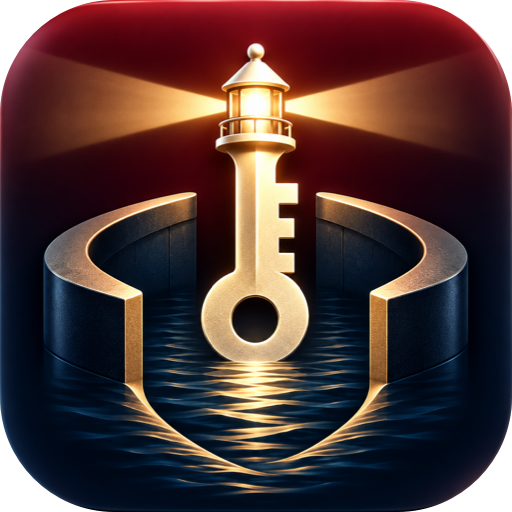
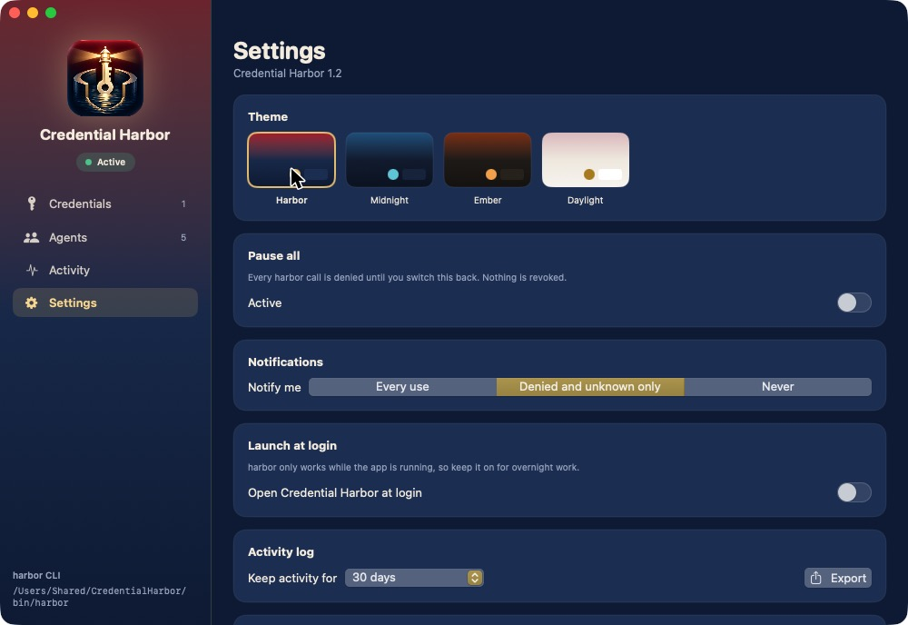

<p align="center"></p>

# Credential Harbor

**Let AI agents use your Mac's Keychain credentials without seeing them.**

AI coding agents (Claude Code, Codex, Cursor, your own bots) keep stopping to ask for a
password, an API key or a sudo prompt. Pasting secrets into a chat puts them in transcripts
and logs. Credential Harbor is a small macOS app plus a `harbor` CLI. You approve credentials
once, you decide which agent may use which one, and agents run commands with those
credentials injected. The values never enter the model's context.

```sh
harbor run --stdin AI-Server -- ssh server.local 'sudo -S -p "" launchctl list'
harbor run -- curl -sk -u '{{AI-Router.user}}:{{AI-Router}}' https://router.lan/api/status
harbor run --env TF_VAR_client_secret='{{AI-CloudAPI}}' -- terraform plan
```

<p align="center"></p>

## How it works

* **You approve credentials.** Add one in the app, or approve any login-keychain item whose name
  starts with `AI-`. **Scan** (↻) re-checks the Keychain, and Harbor also rescans whenever you switch back to it. Harbor keeps its own copy, which macOS lets only Harbor read.
* **You register agents.** Each agent gets a key (`HARBOR_AGENT_KEY`) that goes in its
  environment or config, never in a prompt. A new agent can use nothing until you tick credentials for it.
* **Agents call `harbor`.** The CLI sends the agent key and the credential names to the app over a
  local socket, gets the values back, and runs the command **as the caller**. Secrets are injected
  through `{{AI-X}}` / `{{AI-X.user}}` placeholders, `--env`, `--stdin`, or `--askpass` (answers ssh
  and `sudo -A` prompts). Every occurrence in the output is replaced with `{{AI-X}}`.
* **You stay in control.** Activity log (who, what, exit code), per-agent pause, revoke, Pause all,
  notifications for denied or unknown callers, a per-credential health check, and four themes.
  **Replace secret** rotates a credential without touching who may use it.
* **It lives in the menu bar.** Harbor starts in the background with a menu bar icon showing
  whether it's serving agents and the last few requests. Open the window from there; closing it
  keeps Harbor running. Turn on **Start in the menu bar at login** for overnight work.
* **Background jobs never get a dialog.** `harbor run --noninteractive …` doesn't start the app or
  show any Keychain prompt: it exits 77 if the request is denied, the keychain is locked or macOS
  would ask, 69 if the app isn't running, and 64 if the app is too old for the mode.
* **Services can use a key file.** For an **Other** agent, **Write key file** saves its key to
  `/Users/Shared/CredentialHarbor/keys/<agent-name>.key` (0600, in a 0700 folder), so a
  LaunchAgent or daemon can read it at startup instead of holding it in its config.

Permissions last until you revoke them: no timers, and no prompt per command.

## Install (build from source)

Requires macOS 15+ and Xcode 16+.

```sh
git clone https://github.com/DevGTSolution/credential-harbor.git
cd credential-harbor
zsh build-app.sh --install    # → ~/Applications/Credential Harbor.app
```

On first launch the app installs the CLI to `/Users/Shared/CredentialHarbor/bin/harbor`, and the
build links it to `~/.local/bin/harbor`. Turn on **Settings → Launch at login**, because `harbor`
only works while the app is running.

**Signing matters.** macOS remembers "Always Allow" for Keychain access per Team ID. If you have
an *Apple Development* certificate (free with any Apple ID: Xcode → Settings → Accounts → Manage
Certificates → +), `build-app.sh` signs with it, and rebuilds keep access. Otherwise the app is signed
ad hoc, and macOS asks again for each credential after every rebuild. If the certificate shows as
invalid, install Apple's [WWDR G3 intermediate](https://www.apple.com/certificateauthority/).

## Set up an agent

1. **Agents → Add** (or pick Claude / Codex / Cursor), then **Generate key**. The Connect screen has two steps:
   * **Give it its key.** For Claude Code and Codex, **Add key to … config** writes `HARBOR_AGENT_KEY`
     into `~/.claude/settings.json` or `~/.codex/config.toml`, keeping a `.before-harbor` backup. For Codex it
     also sets `[sandbox_workspace_write] network_access = true`, because Codex's sandbox otherwise blocks the
     Harbor socket. For other agents, copy the setup line into their environment. The key belongs in config,
     never in a prompt.
   * **Tell it to use Harbor.** Use **Copy AI instructions** and paste them into its system prompt, `AGENTS.md`
     or `CLAUDE.md`. They contain no secrets.
2. Tick the credentials it may use.
   * **Tools you can't give a key to**: use **Linked apps** instead: an app (e.g. Cursor.app) or the folder a CLI agent runs from (e.g. `~/.local/share/cursor-agent`), several per agent. Harbor asks macOS for the PID on
     the other end of the socket and walks up its parent processes. Any `harbor` call launched by that app
     counts as the agent, with no key needed. The caller can't set that chain, unlike an environment variable.
3. Restart the agent so it picks up the new environment, then have it run `harbor doctor`.

If an agent can't edit its own config, the Connect screen also offers a one-message self-setup prompt.
It contains the key, so it stays in that chat's history.

`harbor list` shows an agent what it may use, along with your notes. Exit code 77 means "not allowed";
69 means the CLI can't reach the app. `harbor doctor` says why: the app isn't running, the agent can't see
`/Users/Shared` (container/VM), or **the agent's sandbox blocks local sockets**. Many agent sandboxes do this
by default, so allow that agent to reach `/Users/Shared/CredentialHarbor/harbor.sock`.

**Codex:** threads get their sandbox from the app, and `config.toml` network settings may not apply. Add
narrow allow rules to `~/.codex/rules/default.rules` and have the agent request escalated execution
(`sandbox_permissions: "require_escalated"`) for `harbor`. The rule then approves it without a prompt:

```python
prefix_rule(pattern=["harbor", ["list", "doctor", "help"]], decision="allow")
prefix_rule(pattern=["harbor", "run", ["--stdin", "--askpass"], "AI-Server", "--", "ssh"], decision="allow")
```

Never add a bare `["harbor"]` rule: `harbor run` can wrap any command.

## Agents in Docker containers

macOS sockets don't reach into Docker's Linux VM, so turn on **Settings → Containers**. Harbor then also
listens on `127.0.0.1:47821`, which Docker Desktop exposes to containers as `host.docker.internal:47821`
(other machines can't connect). Inside the container, use `harbor-container`, a dependency-free Python 3
version of the CLI with the same commands:

Give the agent the **Hermes** (container) type, then **Generate key → Write key file**. Harbor writes it to
`/Users/Shared/CredentialHarbor/keys/<agent>.key`, in a folder only you can read, and rewrites it in place when you
replace the key, so a running container sees the new one. Mount it Docker-secret style:

```yaml
# compose override: two read-only mounts, nothing else
services:
  agent:
    volumes:
      - /Users/Shared/CredentialHarbor/bin:/opt/harbor:ro
      - /Users/Shared/CredentialHarbor/keys/hermes.key:/run/secrets/harbor_agent_key:ro
```

Create the key file before starting the container; otherwise Docker creates a directory at that path.
`harbor-container` also accepts `HARBOR_AGENT_KEY` or `HARBOR_AGENT_KEY_FILE`.

```sh
python3 /opt/harbor/harbor-container doctor
python3 /opt/harbor/harbor-container run --stdin AI-Server -- ssh server.local 'sudo -S -p "" uptime'
```

Container callers always need a key: Harbor can't see their process tree.

## Tested agents

| Agent | How it's recognized | Notes |
|---|---|---|
| Claude Code | key in `~/.claude/settings.json` (Connect button) | no sandbox by default |
| Codex (desktop / remote threads) | key in `~/.codex/config.toml` (Connect button) | sandbox blocks the socket: allow rules + `require_escalated` |
| Cursor | key in Cursor's terminal env, or Linked app `Cursor.app` | link `~/.local/share/cursor-agent` for the CLI |
| Electron agent apps with a local exec daemon | Linked app | no key needed |
| Hermes / any Docker agent | key file mounted at `/run/secrets/harbor_agent_key` | `harbor-container` over `host.docker.internal:47821` |

## Security model: read this

Credential Harbor keeps secrets out of model context and out of logs. It is **not** a sandbox.

* Agent keys give attribution and per-agent limits, not proof of identity. Any process running as
  your user can read another agent's config, and Harbor policy lives in your home folder.
* Redaction prevents accidents. An agent that deliberately wants a value it is allowed to use can get
  it (`--env P='{{AI-X}}' -- sh -c 'echo $P | rev'`). Only grant credentials you would trust that agent
  with, and prefer least-privilege accounts and tokens.
* `--env` and `--askpass` put the value in the child process's environment, which is visible to
  same-user processes. `{{…}}` in arguments is visible in `ps`.
* The socket (`/Users/Shared/CredentialHarbor/harbor.sock`) accepts any local user. A valid agent key
  is what grants anything. That lets a service account run agents while the owner's session holds the
  Keychain.

## Development

```sh
swift run HarborChecks                       # logic checks
swift tools/make-icon.swift Resources/source-icon.png Resources \
  && iconutil -c icns Resources/AppIcon.iconset -o Resources/AppIcon.icns
```

`Sources/HarborCore` holds the Keychain vault, command runner, redaction and the socket protocol.
`Sources/CredentialHarbor` is the SwiftUI app and broker. `Sources/harbor` is the CLI.

## License

[MIT](LICENSE)
